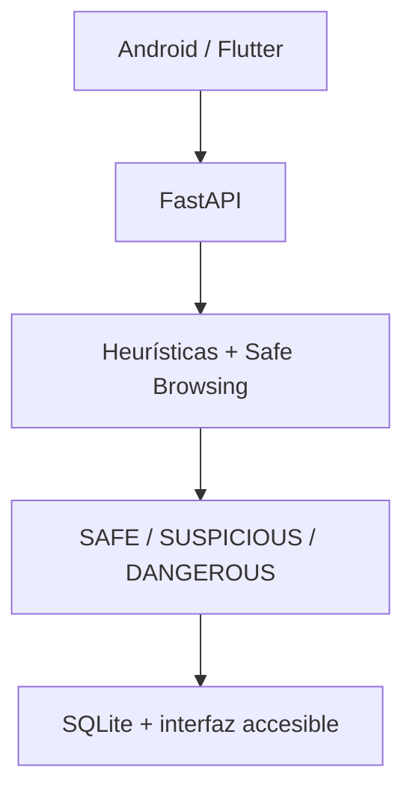

# ProtegeLink

ProtegeLink es una aplicación académica Android que ayuda a revisar enlaces antes de abrirlos y comunica el riesgo con palabras claras. Está orientada principalmente a adultos mayores.

> ProtegeLink es un proyecto educativo, no un antivirus ni un producto comercial. Ningún análisis puede garantizar la detección del 100 % de los sitios fraudulentos.

## Problema

Los enlaces fraudulentos suelen imitar servicios conocidos y usar mensajes urgentes. Las personas adultas mayores pueden tener más dificultades para interpretar señales técnicas o advertencias poco claras.

## Objetivo

Analizar una URL antes de permitir su navegación y clasificarla como `SAFE`, `SUSPICIOUS` o `DANGEROUS`. La aplicación explica los motivos sin depender solo del color.

## Alcance académico

El alcance actual es Android 10 o superior. No incluye iOS, web, cuentas de usuario, autenticación, panel administrativo, base de datos remota ni inteligencia artificial generativa.

## Arquitectura



La app nunca consulta Google directamente: el backend protege la clave y combina la reputación externa con reglas sencillas y explicables.

## Estructura del proyecto

- `mobile/`: aplicación Flutter Android-first, navegación y cliente REST.
- `backend/`: API FastAPI, motor heurístico e integración opcional con Safe Browsing.
- `docs/`: arquitectura y límites del proyecto.
- `scripts/`: comandos auxiliares para desarrollo local.

## Requisitos

- Flutter estable con Dart compatible.
- Android SDK con una plataforma Android reciente y Java compatible con Flutter.
- Python 3.10 o superior.
- Git.

## Levantar el backend

En PowerShell, desde la raíz:

```powershell
cd backend
python -m venv .venv
.\.venv\Scripts\Activate.ps1
python -m pip install --upgrade pip
python -m pip install -e ".[dev]"
Copy-Item .env.example .env
uvicorn app.main:app --reload --host 0.0.0.0 --port 8000
```

Comprobación: abrir `http://127.0.0.1:8000/health` o ejecutar `Invoke-RestMethod http://127.0.0.1:8000/health`.

Calidad del backend:

```powershell
ruff check .
ruff format --check .
pytest
```

## Ejecutar Flutter

Desde la raíz:

```powershell
cd mobile
flutter pub get
dart format .
flutter analyze
flutter test
flutter run
```

La URL predeterminada se compila dentro del APK desde `mobile/lib/core/constants/app_config.dart`. El valor actual es `http://192.168.100.18:8000` y se puede cambiar en la constante `bundledApiBaseUrl` antes de compilar.

## Celular Android real

`localhost` en el teléfono es el propio teléfono, no la computadora. Ambos dispositivos deben estar en la misma red local y el firewall debe permitir el puerto 8000.

Después de instalar el APK, abrir **Configuración → Dirección del backend** e ingresar la IP que la red compartida asignó a la notebook, por ejemplo `http://192.168.43.25:8000`. El valor queda guardado en el teléfono y se usa desde el siguiente análisis, sin reinstalar la aplicación.

También se puede dejar fija otra dirección para futuras compilaciones modificando `bundledApiBaseUrl` en el código.

Ejemplo indicando un dispositivo concreto:

```powershell
flutter run -d DEVICE_ID --dart-define=API_BASE_URL=http://192.168.100.72:8000
```

`--dart-define` queda disponible como override opcional de compilación; ya no es necesario para ejecutar ni generar el APK. El teléfono y la computadora deben estar en la misma red. El backend debe ejecutarse con `--host 0.0.0.0` y el firewall debe permitir el puerto 8000.

## Variables de entorno

El backend lee:

- `GOOGLE_SAFE_BROWSING_API_KEY`: opcional. Sin clave se usan únicamente heurísticas.
- `DEMO_MODE`: `false` por defecto. Cuando vale `true`, habilita solamente los tres casos controlados documentados en `docs/demo.md`.

La app incluye `bundledApiBaseUrl` dentro del APK, admite el override opcional `API_BASE_URL` mediante `--dart-define` y permite guardar una dirección distinta desde Configuración. Esta facilidad y el uso de HTTP están destinados únicamente a la demostración académica local.

## Integración Android

El manifiesto declara `INTERNET` y filtros no verificados para recibir enlaces HTTP/HTTPS y texto compartido. `ACTION_SEND` y `ACTION_VIEW` están conectados mediante un canal Kotlin pequeño: la URL se extrae y se precarga en la pantalla de análisis. Configuración permite abrir los ajustes de aplicaciones predeterminadas de Android, pero ProtegeLink nunca obliga a seleccionarlo.

## Generar APK

Debug:

```powershell
cd mobile
flutter build apk --debug
```

Release usando la URL incluida en el código:

```powershell
flutter build apk --release
```

El APK se genera en `mobile/build/app/outputs/flutter-apk/`. Si la IP cambia al conectarse al hotspot, se corrige desde **Configuración → Dirección del backend**. El manifiesto permite HTTP sin cifrar únicamente para facilitar la demostración académica local; una publicación real debe usar HTTPS y una configuración de seguridad más restrictiva.

La guía [docs/demo.md](docs/demo.md) contiene un recorrido reproducible de cinco minutos con casos controlados para los tres estados.

## Estado actual

- [x] estructura base
- [x] navegación
- [x] backend FastAPI
- [x] análisis heurístico inicial
- [ ] integración completa Safe Browsing
- [ ] navegador predeterminado
- [x] recepción de texto compartido con ACTION_SEND
- [x] recepción de enlaces con ACTION_VIEW
- [x] historial SQLite
- [x] WebView limitado a resultados SAFE
- [ ] diseño final Stitch
- [ ] pruebas con dispositivo físico

## Seguridad y limitaciones

Los pesos heurísticos son demostrativos y ajustables. Cada palabra sensible distinta suma 5 puntos, hasta un máximo de 25, para que repetir un término no determine por sí solo la clasificación. Pueden existir falsos positivos y falsos negativos; una puntuación baja no prueba que un sitio sea legítimo. Safe Browsing se usa solo si hay una clave configurada y su respuesta puede fallar o no contener amenazas nuevas.

El backend no visita la URL, no descarga HTML y no realiza crawling. El WebView solo acepta como entrada un análisis `SAFE`; las redirecciones y navegaciones internas todavía no se vuelven a analizar. La [API Safe Browsing v5](https://developers.google.com/safe-browsing/reference/rest/v5/urls/search) está destinada a usos no comerciales; para un producto comercial se debe revisar Google Web Risk y sus condiciones.
